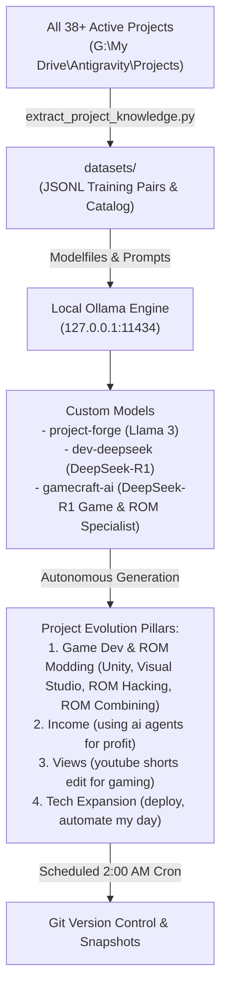

# How to Train Your AI: Autonomous Multi-Project Ecosystem

A centralized engine designed to continuously train, align, and leverage local LLMs (via Ollama & GitHub) to power development across all personal projects, with a strong focus on **Income Generation**, **Audience Growth (Views)**, **Technical Expansion**, and **Game Development**.

---

## 🚀 System Architecture

---

## 🛠️ Components

1. **`train_and_evolve.ps1`**:
   - Master PowerShell orchestration script.
   - Verifies Ollama background daemon on port 11434.
   - Scans 38+ local projects across G: Drive and rebuilds training datasets.
   - Re-compiles `project-forge`, `dev-deepseek`, and `gamecraft-ai` custom models.
   - Generates daily strategic roadmaps and executable code.
   - Automatically commits changes to Git.

2. **`Modelfile.gamecraft` (`gamecraft-ai`)**:
   - High-reasoning game engineering model fine-tuned on:
     - **Unity & Visual Studio**: C# ScriptableObject architecture, UniTask async loops, ASMDEF optimization, Prefab variants.
     - **ROM Modding**: Binary patching (IPS, BPS, xdelta3), disassembly (6502, 65816, ARM7, PowerPC), asset injection (GameCube ARC/AST/SuperBMD).
     - **Combining ROMs**: Multi-ROM consolidation, cross-game SRAM inventory synchronization, APU sound driver resets, transition warps.

3. **`Modelfile.forge` & `Modelfile.deepseek_dev`**:
   - **`project-forge`**: High-creativity, strategic model built atop `llama3:latest` for monetization, content pipelines, and architecture.
   - **`dev-deepseek`**: High-reasoning analytical model built atop `deepseek-r1:7b` for code synthesis, game engine loops, and reverse engineering.

3. **`extract_project_knowledge.py`**:
   - Automated parser generating JSONL instruction-tuning pairs and metadata catalogs from active project workspaces.

4. **Automation Schedule**:
   - Scheduled via Antigravity Cron to run nightly at **2:00 AM CST**.
