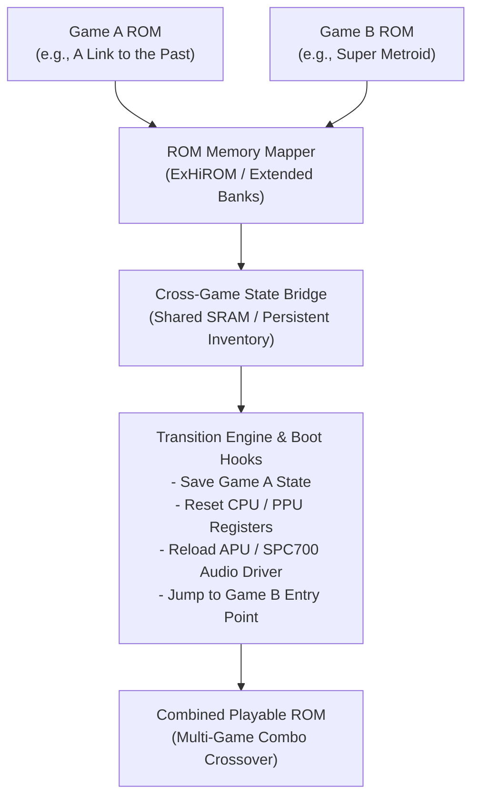

# Comprehensive ROM Modding, ROM Combining & Unity Game Dev Guide

## 1. Unity & Visual Studio Engineering
- **Architecture**: Decoupled, event-driven ScriptableObject architecture.
- **Assembly Definitions (`.asmdef`)**: Partition scripts into distinct compilation units to optimize Visual Studio build times and enforce architectural boundaries.
- **Async Game Loops**: Implement `UniTask` to avoid Garbage Collection allocations and manage frame-accurate timing.
- **AI Integration**: Connect Unity directly to local Ollama endpoints (`http://127.0.0.1:11434/api/generate`) using structured JSON payloads to govern dynamic NPC actions, dialogue, and procedural encounter parameters.

---

## 2. ROM Modding & Binary Reverse Engineering

### System Specifications
| System | Processor | Addressing | Patch Standard | Common Asset Formats |
| :--- | :--- | :--- | :--- | :--- |
| **NES** | 6502 (8-bit) | 16-bit (Mappers e.g. MMC3) | IPS, BPS | 2bpp planar CHR-ROM |
| **SNES** | 65816 (16-bit) | 24-bit (LoROM / HiROM / ExHiROM) | BPS (Headerless) | 4bpp planar, BGR555 palettes, SPC700 audio |
| **GBA** | ARM7TDMI (32-bit) | 32-bit (ROM at `0x08000000`) | BPS, UPS | 4bpp / 8bpp tiles, BGR555, GBA BIOS calls |
| **GameCube** | PowerPC 750 (Gekko) | 32-bit FST/DOL Filesystem | xdelta3, PPF | `.arc` (archives), `.ast` (audio), `.bmd` (3D models) |

### Binary Patching Standards
- **IPS**: Simple 3-byte offset records, limited to 16MB file sizes.
- **BPS**: Linear & source-relative offset diffing with CRC32 checksum verification.
- **xdelta3**: VCDIFF byte-level compression, ideal for large ISO/DOL GameCube disc modifications.

---

## 3. Combining ROMs & Combo Hacks (e.g. SMZ3)

### 5 Critical Steps for Cross-Game ROM Combination:
1. **Memory Map Consolidation**:
   - Merge ROM spaces into extended memory banks (e.g. ExHiROM 48Mbit / 6MB or custom mapper chips) so both game binaries coexist without memory overlap.
2. **Shared SRAM State Bridge**:
   - Structure a persistent cross-game save block in battery-backed SRAM. Track shared progression items (e.g. key items, upgrades, abilities) across both engine contexts.
3. **Transition Hooks & Area Warps**:
   - Hook doorway, portal, or warp triggers. When transitioning, execute an assembly stub that saves the active game state and prepares registers for the target game.
4. **Hardware & Sound Driver Reinitialization**:
   - Reset video (PPU) registers, DMA channels, and CPU flags. Re-flash the audio coprocessor (e.g., SPC700 APU) with the destination game's audio driver and sample instruments.
5. **Logic Graph & Reachability Validation**:
   - Build automated graph-traversal scripts (in Python or C#) to simulate item distribution and ensure all game states are mathematically solvable without softlocks.
